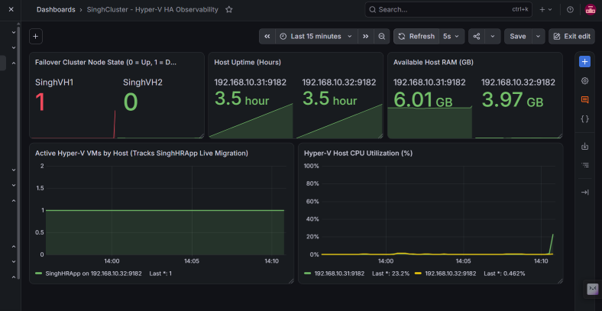

# Windows Server High Availability (HA) Failover Cluster Lab

An end-to-end, PowerShell-automated **Windows Server Failover Clustering (WSFC)** architecture hosting a Highly Available HR Web Application (`SinghHRApp`) backed by centralized iSCSI shared storage and Cluster Shared Volumes (CSV)[cite: 7].

## Architecture & Network Topology (`192.168.10.0/24`)

All virtual machines operate on an isolated Hyper-V Internal Virtual Switch (`Lab-Internal`), with nested virtualization enabled on both cluster nodes and a synchronized `Cluster-Switch` connecting the clustered workload[cite: 7].

```text
+---------------------------------------------------------------------------------------------------+
|                        PHYSICAL HOST: Windows 11 Enterprise (32 GB RAM)                           |
|                                                                                                   |
|   +-------------------------------------------------------------------------------------------+   |
|   |              HYPER-V INTERNAL VIRTUAL SWITCH: "Lab-Internal" (192.168.10.0/24)            |   |
|   |                                   Host Gateway: 192.168.10.1                              |   |
|   +-----+--------------------------+--------------------------+-------------------------+-----+   |
|         |                          |                          |                         |         |
|         v                          v                          v                         v         |
|  +--------------+        +--------------------+      +-----------------+       +-----------------+ |
|  |   SinghDC    |        |     SinghISCSI     |      |    SinghVH1     |       |    SinghVH2     | |
|  | 192.168.10.10|        |    192.168.10.20   |      |  192.168.10.31  |       |  192.168.10.32  | |
|  +--------------+        +--------------------+      +-----------------+       +-----------------+ |
|  | - AD DS      |        | - iSCSI Target Svr |      | - Hyper-V Node1 |       | - Hyper-V Node2 | |
|  | - DNS Server |        | - IQN Target:      |      | - Failover Clus |       | - Failover Clus | |
|  | - Domain:    |        |   SinghClusterTarget      | - Nested Virt   |       | - Nested Virt   | |
|  |  singh.local |        |                    |      | - 5 GB RAM      |       | - 5 GB RAM      | |
|  +--------------+        |  Shared Storage:   |      +--------+--------+       +--------+--------+ |
|                          |  +--------------+  |               |                         |         |
|                          |  | Quorum.vhdx  |  |               |  iSCSI Initiator (MP/IO) |         |
|                          |  | (2 GB Disk)  |--+---------------+-------------------------+         |
|                          |  +--------------+  |               |                         |         |
|                          |  |ClusterCSV.vhdx  |               |                         |         |
|                          |  | (80 GB Disk) |--+---------------+-------------------------+         |
|                          |  +--------------+  |               |                         |         |
|                          +--------------------+               |                         |         |
|                                                               v                         v         |
|   +-------------------------------------------------------------------------------------------+   |
|   |                 FAILOVER CLUSTER: "SinghCluster" (Cluster VIP: 192.168.10.40)             |   |
|   |                                                                                           |   |
|   |   [Quorum Mode: Node + Disk Majority]         [Cluster Shared Volume: Volume2 (80 GB)]    |   |
|   |    - SinghVH1 (1 Vote)                         - Mounted at: C:\ClusterStorage\Volume2    |   |
|   |    - SinghVH2 (1 Vote)                         - Simultaneous Read/Write across nodes     |   |
|   |    - Cluster Disk 2: 2 GB Witness (1 Vote)                                                |   |
|   |                                                                                           |   |
|   |   +-----------------------------------------------------------------------------------+   |
|   |   |               EXTERNAL VIRTUAL SWITCH: "Cluster-Switch" (Both Nodes)              |   |
|   |   +-----------------------------------------+-----------------------------------------+   |
|   |                                             |                                             |   |
|   |                                             v (Live Migration / Automatic Failover)       |   |
|   |                        +-----------------------------------------+                        |   |
|   |                        |     CLUSTERED ROLE: "SinghHRApp"        |                        |   |
|   |                        |         IPv4: 192.168.10.50/24          |                        |   |
|   |                        +-----------------------------------------+                        |   |
|   |                        | - Gen 2 Nested VM (2 vCPU, 2 GB RAM)    |                        |   |
|   |                        | - VHDX Stored on C:\ClusterStorage\Volume2|                        |   |
|   |                        | - IIS Web Server (HTTP Port 80)         |                        |   |
|   |                        | - Firewall: Inbound ICMPv4 Enabled      |                        |   |
|   |                        +-----------------------------------------+                        |   |
|   +-------------------------------------------------------------------------------------------+   |
+---------------------------------------------------------------------------------------------------+
```

## Infrastructure Inventory

| Hostname | Role | IPv4 Address | Specifications |
| :--- | :--- | :--- | :--- |
| **SinghDC** | Active Directory DS & DNS (`singh.local`) | `192.168.10.10` | 2 vCPU, 2 GB RAM |
| **SinghISCSI** | Windows iSCSI Target Server (Shared SAN) | `192.168.10.20` | 2 vCPU, 2 GB RAM, `2 GB` Quorum + `80 GB` CSV |
| **SinghVH1** | Hyper-V & Failover Cluster Node 1 | `192.168.10.31` | 2 vCPU, 5 GB RAM (Nested Virtualization) |
| **SinghVH2** | Hyper-V & Failover Cluster Node 2 | `192.168.10.32` | 2 vCPU, 5 GB RAM (Nested Virtualization) |
| **SinghCluster** | Failover Cluster Administrative Access Point | `192.168.10.40` | Node + Disk Majority Quorum (`2 GB` Witness) |
| **SinghHRApp** | Clustered IIS HR Application VM (Gen 2) | `192.168.10.50` | 2 vCPU, 2 GB RAM, Stored on `C:\ClusterStorage\Volume2` |

## Automation Scripts (`scripts/`)

* [`scripts/01-host-provision-vms.ps1`](scripts/01-host-provision-vms.ps1) — Creates `Lab-Internal` (`192.168.10.1/24`), provisions core VMs, and enables nested virtualization extensions.
* [`scripts/02-iscsi-storage-setup.ps1`](scripts/02-iscsi-storage-setup.ps1) — Initializes SAN storage, installs the iSCSI Target Server role, and maps the `2 GB` Quorum and `80 GB` CSV VHDXs.
* [`scripts/03-cluster-deploy.ps1`](scripts/03-cluster-deploy.ps1) — Connects persistent iSCSI LUNs, installs Failover Clustering, runs `Test-Cluster`, and configures `SinghCluster`.
* [`scripts/04-ha-vm-deploy.ps1`](scripts/04-ha-vm-deploy.ps1) — Binds `Cluster-Switch`, provisions `SinghHRApp` on `C:\ClusterStorage\Volume2`, deploys IIS, and configures ICMPv4 firewall rules.
* [`scripts/05-failover-monitor.ps1`](scripts/05-failover-monitor.ps1) — Real-time ICMP and HTTP 200 telemetry loop for measuring recovery time during Live Migration and node crashes.

## High Availability Validation Evidence (`evidence/`)

### 1. Active Directory Domain Membership (`singh.local`)
Verified domain controller configuration and computer object registration across `SinghDC`, `SinghISCSI`, `SinghVH1`, and `SinghVH2`[cite: 4].


### 2. Quorum Witness & Cluster Shared Volume (`Volume2`)
Confirmed Node + Disk Majority quorum (`Cluster Disk 2`) and online Cluster Shared Volume (`Cluster Disk 1` mounted at `C:\ClusterStorage\Volume2`).


### 3. Planned Maintenance: Zero-Downtime Live Migration
Executed `Move-ClusterVirtualMachineRole` between `SinghVH1` and `SinghVH2` while serving the HR Web Portal (`http://192.168.10.50`) with zero HTTP interruption[cite: 3].


### 4. Unplanned Outage: Automated Node Crash Failover
Simulated hard power loss on the active owner node (`Stop-VM -Name "SinghVH2" -TurnOff -Force`)[cite: 6]. `SinghCluster` maintained quorum via the iSCSI Disk Witness and automatically restarted `SinghHRApp` on `SinghVH1`, restoring `HTTP 200` availability[cite: 5].


> **Official Cluster Validation Report:** View the full Microsoft Failover Cluster Validation logs at [`evidence/Validation Report 2026.11.17 At 21.19.09.htm`](evidence/Validation%20Report%202026.11.17%20At%2021.19.09.htm) ([XML](evidence/Validation%20Report%202026.11.17%20At%2021.19.09.xml))[cite: 9].

## Real-Time Cluster Observability (Prometheus + Grafana)

Deployed Prometheus `windows_exporter` (v0.32.1 with `hyperv` and `mscluster` collectors) on `SinghVH1` (`192.168.10.31:9182`) and `SinghVH2` (`192.168.10.32:9182`), scraped by a containerized **Prometheus + Grafana** stack (`monitoring/docker-compose.yml`).

* **Cluster Node Health:** Tracks `windows_mscluster_node_state` (`0 = Up`) across both Hyper-V cluster nodes.
* **Live Migration Ownership Tracking:** Graphs `windows_hyperv_vm_state{state="running"}` per host to visualize `SinghHRApp` shifting between `SinghVH1` and `SinghVH2` in real time.
* **Host Resource Telemetry:** Monitors Hyper-V host CPU utilization (`windows_cpu_time_seconds_total`), available physical RAM (`windows_memory_available_bytes`), and uptime.



## Hybrid Off-Site Disaster Recovery (Azure Site Recovery)

To protect against total on-premises site loss beyond single-node Hyper-V failover, `SinghHRApp` is continuously replicated to a cloud **Off-Site Backup Bunker** in **Microsoft Azure** using the **Hyper-V to Azure (without VMM)** architecture.

### Hybrid Architecture Flow

* **On-Premises Cluster (`Singh-HyperV-Cluster`):** Both `SinghVH1` (`192.168.10.31`) and `SinghVH2` (`192.168.10.32`) run the **Azure Site Recovery Provider** and **MARS Agent**, tracking disk changes on `Cluster Disk 2` (CSV) and shipping delta blocks over outbound HTTPS (`TCP 443`) via the Windows 11 NAT gateway (`SinghLabNAT` / `192.168.10.1`).
* **Cluster-Aware Failover Tracking:** If `SinghHRApp` live-migrates or fails over locally between `SinghVH1` and `SinghVH2`, ASR automatically detects role ownership changes and resumes delta replication from the new owner node.
* **Azure Control & Storage Plane (`RG-Singh-ASR-Bunker`):**
  * **Recovery Services Vault:** `RSV-Singh-Bunker` (orchestrates replication policies, health heartbeats, and failover triggers).
  * **Replication Policy (`Singh-Lab-Policy`):** 5-minute copy frequency, 2-hour recovery point retention, 1-hour app-consistent snapshots (achieving ~5-second RPO in steady state).
  * **Standby Storage:** Standard LRS Storage Account (`singhasrbunker01`) holding replicated `.vhdx` blobs with **₹0 idle compute cost** until a failover is triggered.
  * **Target Failover Network:** `VNet-Singh-DR` (`192.168.10.0/24`) provisioning `Standard_B2s` compute on demand.

  ### Repository Additions

| Path | Description |
| :--- | :--- |
| `docs/DR-VALIDATION-REPORT.md` | End-to-end validation log covering Error 68503 remediation, Test Failover blackout drill, live Unplanned Failover, Commit, Reverse Replicate, and Failback. |

## Engineering Lessons & Troubleshooting Solved
* **CSV Redirected Access & Switch Binding:** Binding an external `Cluster-Switch` to a single-NIC nested node momentarily resets network state; re-verifying persistent iSCSI initiator sessions (`MSiSCSI`) ensures CSV direct I/O remains healthy before VM provisioning.
* **Nested VM Memory Sizing:** Balanced node RAM allocation (`5 GB` per nested Hyper-V host) prevents host memory commit exhaustion (`0x8007000E`) when recovering crashed cluster nodes alongside active workloads[cite: 6].
* **ICMP Firewall Auditing:** Windows Server drops inbound ICMPv4 echo requests by default; configured explicit firewall rules (`ICMPv4 Type 8`) on `SinghHRApp` to enable continuous packet-loss telemetry alongside HTTP health checks.
